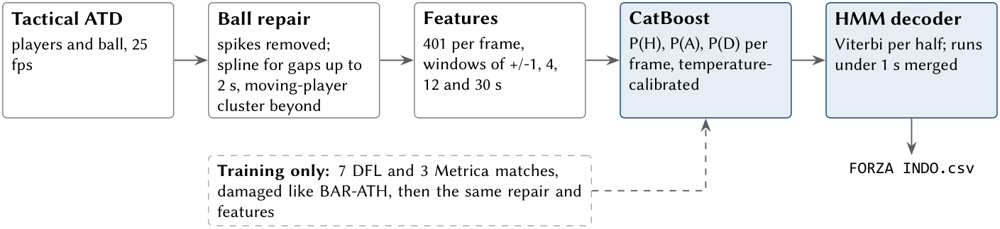
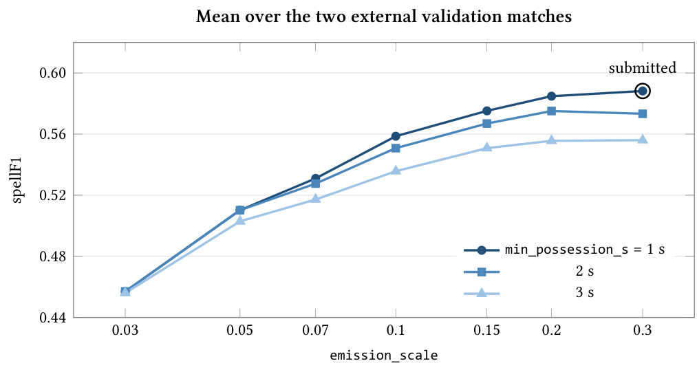

# 1. Approach

We label every frame of the tactical video `H`, `A` or `D` and never abstain. spellF1 scores possessions as whole
intervals, so a model can be right on most frames and still score badly if its labels flicker between teams. We
therefore split the work in two: a frame classifier estimates `P(H)`, `P(A)` and `P(D)` for each frame, and a sequence
decoder turns those probabilities into fewer, longer possessions (Figure 1).



## 1.1 Learning from other matches

Apart from the published five minutes, BAR-ATH has no labels, and the labels we submit have to come from an algorithm.
The classifier is therefore trained on ten public matches. Seven are the DFL / IDSSE Bundesliga matches (Bassek et al.,
2025; CC BY 4.0, [doi:10.6084/m9.figshare.28196177](https://doi.org/10.6084/m9.figshare.28196177)), whose position
files carry ball status and possession for every frame. The other three are the Metrica Sports sample games
([github.com/metrica-sports/sample-data](https://github.com/metrica-sports/sample-data)), where we derive possession
from the event data. We added them despite the extra work because Metrica also produced the BAR-ATH tracking, and
sample game 3 uses the same file format. We used no other external data.

The tracking of these ten matches rarely loses the ball or a player. In BAR-ATH the ball is missing on 41% of the
graded frames, often for long stretches, and players drop out. We measured gap lengths, dropout rates and position
jitter on BAR-ATH itself, which needs no labels, damaged each training match in the same way (twice, with different
random draws) and passed the result through the same preprocessing and feature code as the target. Absolute ball
coordinates are not a feature, so the model cannot learn where on the pitch things happened in particular matches.

## 1.2 Classifier

The features describe the scene around the ball: distances between players and ball, each team's share of the players
near the ball, ball speed and direction, dead-ball cues and team shape, each summarised over windows of +/-1, 4, 12 and
30 s (401 columns). For a missing ball we take the position from a spline for gaps up to 2 s and from the densest
group of moving players for longer gaps. A flag column marks the reconstructed positions.

We fit a multiclass CatBoost model on eight matches with early stopping on the other two: J03WR9 (DFL, Fortuna
Dusseldorf vs 1. FC Kaiserslautern) and METRICA3 (Metrica sample game 3). We calibrate its probabilities with a
temperature fitted on the same two matches. The final model is a refit on all ten matches with 15% more trees than the
early-stopping point, 1,711 in total.

## 1.3 Decoder

Taking the most likely class in each frame scores spellF1 0.29 on the two validation matches, because the labels
flicker; the decoder lifts that to 0.59. The decoder is a three-state HMM over `H`, `A` and `D`. Its transition
probabilities come from the training labels: possessions last 7.3 s on average, dead-ball spells 26.5 s, and 76% of possessions end with the other
team taking the ball directly. The classifier's log probabilities are the emissions, multiplied by `emission_scale`
because neighbouring frames are far from independent evidence. Viterbi runs on each half separately. We fix the known
dead period before the second-half kick-off to `D` and merge any run shorter than `min_possession_s` into the neighbour
the classifier prefers.

## 1.4 Choosing the decoder setting

`emission_scale` and `min_possession_s` are the only values set after training, and we set them on external data
only. `possession/choose_decoder.ipynb` decodes the two validation matches, J03WR9 and METRICA3, with the probabilities
of the model trained without them, for each setting of a fixed 7x3 grid (Figure 2), and keeps the best mean spellF1. It
picked 0.3 and 1.0 s (0.588). The runner-up, 0.2 and 1.0 s, is close behind (0.585), so two matches are a thin basis
for the choice. No BAR-ATH labels and no video enter it.



# 2. Assets used and dropped

| Asset                                    | Status  | How we used it, or why we dropped it                                                                                  |
|:-------------------------------------------|:-------------|:-----------------------------------------------------------------------------------------|
| Tactical ATD                             | Used    | The only input at prediction time                                                                                     |
| DFL / IDSSE matches (CC BY 4.0)          | Used    | 7 training matches, degraded to resemble the ATD                                                                      |
| Metrica sample games                     | Used    | 3 training matches, labels derived from their event data                                                              |
| Public 5-minute ground truth             | Checked | A check on the final file; nothing is trained, tuned or chosen with it                                                |
| Smart Tagging                            | Dropped | Set pieces served as dead-ball evidence in an earlier pipeline of ours (two LightGBM models and Viterbi); the final pipeline takes its dead-ball cues from the tracking alone |
| Broadcast ATD                            | Dropped | We aligned it to the tactical timeline by matching player positions, but it sees the ball in only 7% of the tactical gaps |
| Tactical video, frames and audio         | Not used | The final pipeline reads the tracking only; the video plays no part in training, tuning or prediction               |

# 3. Possession rules

We followed the conventions of the published ground truth. The training labels are built with the same rules, so the
classifier learns them, and the decoder controls their timing.

- Any touch can change possession: an opponent's touch passes the ball to their team. About three
  quarters of possessions in the training labels end this way, and the decoder's transition probabilities reflect it.
- A restart stays dead until a second player touches the ball, so kick-offs, throw-ins, free kicks, corners and goal
  kicks are `D` up to that touch. The DFL ball-status flag turns live at the kick itself, so we moved every
  dead-to-live change in the DFL labels to the first contact by another player: someone other than the kicker within
  1.8 m of the ball while the ball's velocity changes, at most 6 s after the kick. In the Metrica games a restart stays
  dead until the event data shows another player acting.
- Dead ball begins when the ball leaves the pitch or play stops. The classifier sees this as the ball outside the lines,
  all players standing still, or the ball missing for a long time.
- In loose balls and 50/50 challenges the ball stays with the team that last had it until the evidence for the other
  team outweighs the HMM's cost of switching, so a duel does not flicker between teams.
- No possession shorter than 1 s survives decoding; the decoder merges the shortest touches into a neighbour.

# 4. Limitations

We lose the most on short possessions. The smoothing that holds long possessions together also merges the shortest:
over the match we predict 244 possessions with a mean length of 13.8 s, and in the published five minutes 14 where the
ground truth has 17. With more time we would detect individual ball contacts from the player and ball tracks and let
the decoder switch cheaply at a detected contact, instead of applying one switching cost everywhere.

The ball is invisible on 41% of the graded frames. Inside long gaps the model has only player movement and the context
windows to tell which team has the ball, and the broadcast ATD sees the ball in only 7% of those gaps (section 2). Next
we would try a ball detector trained on external footage and applied to the video as an extra input.

The decoder setting rests on two external matches, and the best settings are close (0.588 against 0.585). More
labelled external matches, ideally from the same tracking provider as BAR-ATH, would make the choice firmer.

We followed the conventions of the published ground truth as closely as we could, but five minutes show only a few
restarts and challenges, so the official labels may place some boundaries differently.

On reproducibility: CatBoost uses all CPU threads (`thread_count=-1`). From a fresh clone of the repository with a
fresh install of `requirements.txt`, the committed model reproduces the submitted file byte for byte, and so does a
model retrained from scratch there (same early-stopping point, 1,711 trees). We have not tried other CPUs or operating
systems, so we committed the trained model.

# 5. Reproduction

```bash
python -m pip install -r requirements.txt     # Python 3.10.6, pinned versions
# put the competition bundle under data/ as its DATA.md describes
cd possession
python -m nbconvert --to notebook --execute run_decoder.ipynb --output run.ipynb
```

This takes about 10 minutes. It loads the committed model, parses and cleans the ATD (cached in `possession/artifacts/`),
decodes with the setting in `possession/decoder_choice.json` and writes `output/FORZA INDO.csv`, whose sha256 should be

`dc023a10c259f5c629bbaa7a4ac4f1ba851dc630898b1d26f36c2013b54ba733`

To retrain, delete `possession/models/possession_v1/` and `possession/artifacts/possession_v1_val_probs.npz`, then
run three notebooks in `possession/` the same way: `download_external.ipynb` fetches the external data (2.8 GB,
checksums verified), `train_model.ipynb` trains the model (about 30 minutes on a 16-thread CPU) and
`choose_decoder.ipynb` reruns the decoder choice on the external validation matches (about 2 minutes).

# 6. Results

spellF1 from the competition's scorer, `evaluation/possession_metrics.py`. J03WR9 and METRICA3 are the two external
validation matches, labelled by the model trained without them, and their mean chose the setting. The last column is a
check on the published five minutes of BAR-ATH, on which nothing was tuned or chosen.

| Decoder setting               | J03WR9 | METRICA3 |      Mean | Public 5 min (check) |
|:------------------------------|-------:|---------:|----------:|---------------------:|
| **0.3 / 1.0 s (submitted)**   |  0.567 |    0.610 | **0.588** |            **0.748** |
| 0.2 / 1.0 s                   |  0.562 |    0.608 |     0.585 |                0.748 |
| Argmax, no decoder            |  0.287 |    0.285 |     0.286 |                0.394 |

The public window holds only 17 possessions, enough to show the file is valid and too few to rank settings: both
decoder settings give the same possessions there.

## References

Bassek, M., Rein, R., Weber, H., & Memmert, D. (2025). An integrated dataset of spatiotemporal and event data in elite
soccer. *Scientific Data, 12*, 195. <https://doi.org/10.1038/s41597-025-04505-y>. Dataset (CC BY 4.0):
<https://doi.org/10.6084/m9.figshare.28196177>

Metrica Sports. Sample data. <https://github.com/metrica-sports/sample-data>
